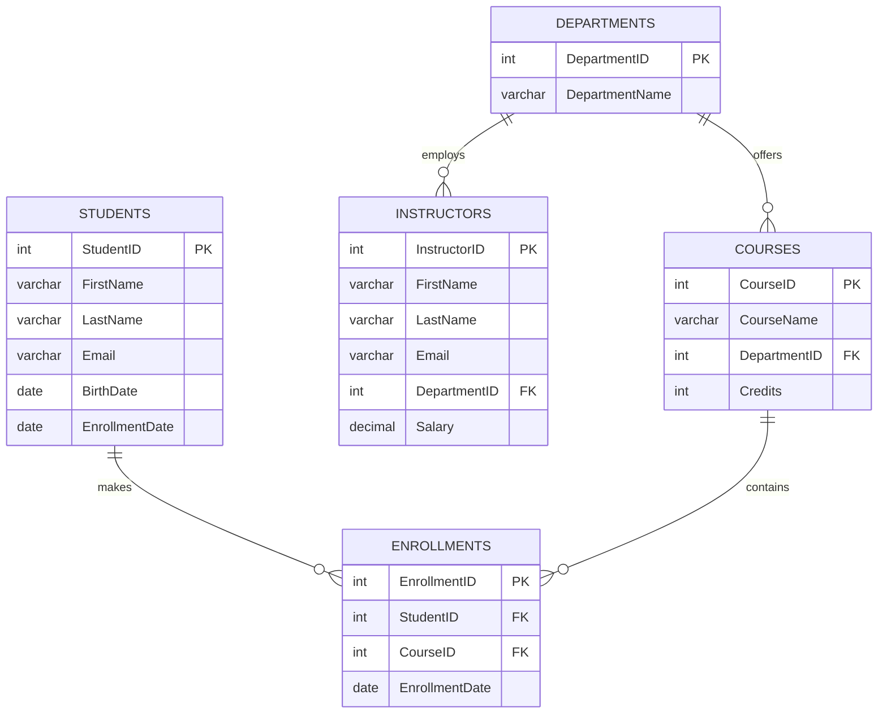

<div align="center">

# 🎓 University Course Management System


**A relational database project built using MySQL to manage university students, courses, instructors, departments, and enrollments.**

</div>

---

## 📌 About The Project

The University Course Management System is a SQL-based database project developed using MySQL.

This project helps manage university information through five relational tables. It demonstrates SQL concepts such as database creation, CRUD operations, joins, subqueries, aggregate functions, date functions, string functions, and window functions.

The project is designed for beginners, SQL practical examinations, and GitHub portfolios.

## 🎯 Project Objectives

- Create a relational database using MySQL.
- Manage student and course information.
- Understand Primary Keys and Foreign Keys.
- Perform CRUD operations.
- Retrieve information using SQL JOINs.
- Analyse data using aggregate functions.
- Practise advanced SQL queries.

## ✨ Features

- Database and table creation.
- Five relational database tables.
- Primary Key and Foreign Key constraints.
- Sample data insertion.
- INSERT, SELECT, UPDATE and DELETE.
- INNER JOIN and LEFT JOIN.
- GROUP BY and HAVING.
- Subqueries.
- Aggregate functions.
- Date and Time functions.
- String functions.
- CASE expressions.
- Window functions.
- Additional SQL practice queries.

## 🗂️ Database Tables

| Table Name | Description |
|---|---|
| departments | Stores department information |
| students | Stores student information |
| courses | Stores university courses |
| instructors | Stores instructor information |
| enrollments | Stores student course enrollments |

## 🧩 Database ER Diagram



## 🛠️ Technologies Used

- MySQL 8.0+
- SQL
- MySQL Workbench
- Git & GitHub
- Markdown

## 📁 Project Structure

```text
University-Course-Management-System/
│
├── university_course_management_system.sql
│
├── screenshots/
│   ├── database.png
│   ├── tables.png
│   └── query-results.png
│
├── README.md
│
└── LICENSE
```

## ⚙️ Installation & Setup

### Step 1: Install MySQL

Install MySQL Server 8.0+ and MySQL Workbench.

### Step 2: Clone Repository

```bash
git clone https://github.com/anghanshrey/university-course-management-system.git
```

### Step 3: Open MySQL Workbench

Open the SQL file:

```text
university_course_management_system.sql
```

### Step 4: Execute SQL Code

Click the Execute button (⚡) in MySQL Workbench.

### Step 5: Verify Database

```sql
USE university_management;

SHOW TABLES;

SELECT * FROM departments;
SELECT * FROM students;
SELECT * FROM courses;
SELECT * FROM instructors;
SELECT * FROM enrollments;
```

## 📚 SQL Concepts Covered

| SQL Topic | Concepts |
|---|---|
| DDL | CREATE, ALTER, DROP |
| DML | INSERT, UPDATE, DELETE |
| DQL | SELECT |
| DCL | GRANT, REVOKE |
| TCL | COMMIT, ROLLBACK |
| Joins | INNER, LEFT, RIGHT, SELF |
| Aggregate | COUNT, SUM, AVG, MIN, MAX |
| Clauses | WHERE, GROUP BY, HAVING, ORDER BY |
| Date Functions | DATE, YEAR, MONTH, DATEDIFF |
| String Functions | CONCAT, UPPER, LOWER |
| Subqueries | Nested Queries |
| Window Functions | ROW_NUMBER, RANK, DENSE_RANK |
| Conditional | CASE WHEN |
| Set Operations | UNION, UNION ALL |

## 📝 Project Tasks – 16 SQL Questions

1. Perform CRUD operations on all tables.
2. Find students enrolled after 2022.
3. Retrieve Mathematics courses with LIMIT 5.
4. Count students in each course having more than 5 students.
5. Find students enrolled in both SQL and Data Structures.
6. Find students enrolled in either SQL or Data Structures.
7. Calculate average credits of all courses.
8. Find maximum instructor salary in Computer Science.
9. Count students enrolled in each department.
10. Retrieve students and courses using INNER JOIN.
11. Retrieve all students using LEFT JOIN.
12. Find students enrolled in courses having more than 10 students.
13. Extract the enrollment year.
14. Concatenate instructor first and last names.
15. Calculate running total using a window function.
16. Classify students as Senior or Junior using CASE.

## 💡 Sample SQL Queries

### 1. Display All Students

```sql
SELECT * FROM students;
```

### 2. Find Students Enrolled After 2022

```sql
SELECT *
FROM students
WHERE EnrollmentDate > '2022-12-31';
```

### 3. Count Students in Each Course

```sql
SELECT
    CourseID,
    COUNT(StudentID) AS TotalStudents
FROM enrollments
GROUP BY CourseID;
```

### 4. INNER JOIN Students and Courses

```sql
SELECT
    s.FirstName,
    s.LastName,
    c.CourseName
FROM students s
INNER JOIN enrollments e
ON s.StudentID = e.StudentID
INNER JOIN courses c
ON e.CourseID = c.CourseID;
```

### 5. Find Maximum Instructor Salary

```sql
SELECT MAX(Salary) AS MaximumSalary
FROM instructors;
```

## 📸 Project Screenshots

Add your actual MySQL Workbench screenshots here.

<div align="center">

### Database Tables


### SQL Query Results


</div>

## 🎓 Learning Outcomes

- Understanding relational database management.
- Creating database tables and relationships.
- Writing SQL queries.
- Working with different types of JOINs.
- Using aggregate and date functions.
- Understanding subqueries and window functions.
- Analysing real-world database information.

## 🚀 Future Improvements

- Student Login System.
- Course Registration System.
- Student Attendance Management.
- Marks and Grades Management.
- Web-based University Dashboard.
- Student Performance Reports.

## 👨‍💻 Author

<div align="center">

### Shrey Anghan

**Full Stack Developer | SQL Learner**

[](https://github.com/anghanshrey)

[](https://www.linkedin.com/)

</div>

---

<div align="center">

### ⭐ If you like this project, give it a star!

**Made with ❤️ using MySQL**


</div>
